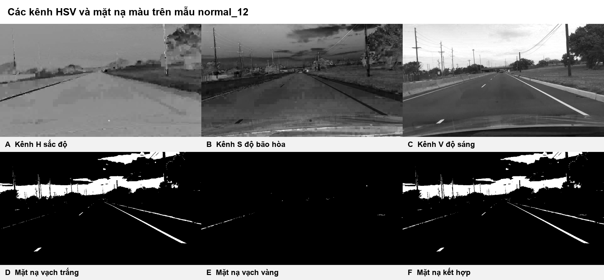
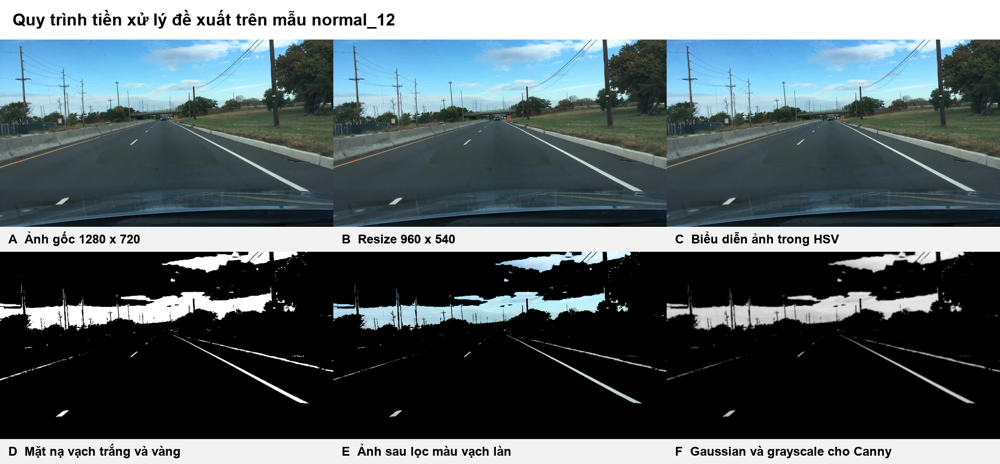
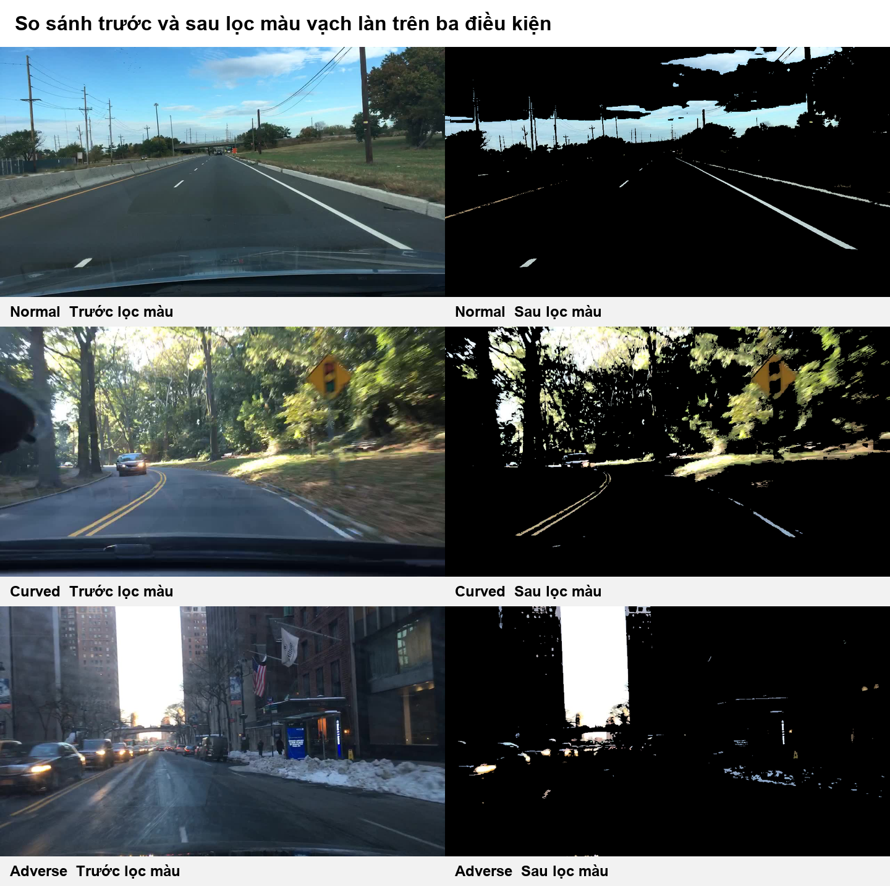
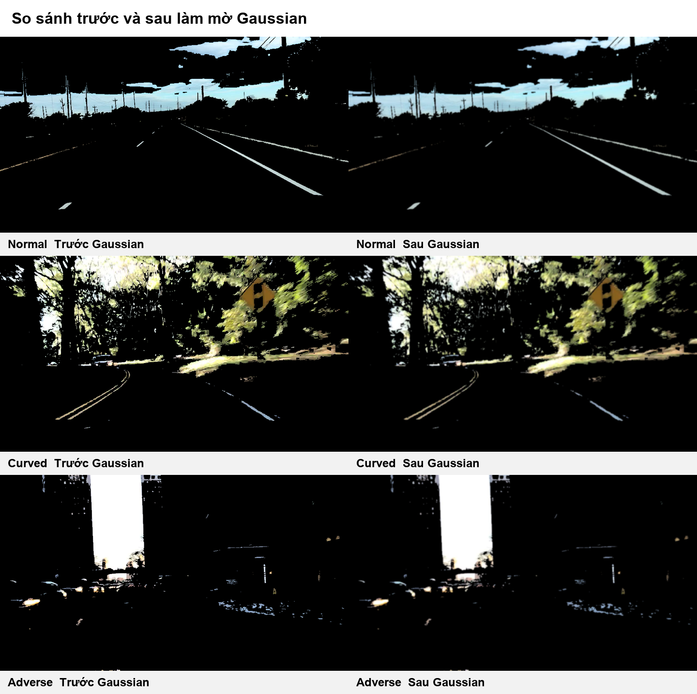

# BÁO CÁO PHẦN 2 TIỀN XỬ LÝ ẢNH BẰNG KHÔNG GIAN MÀU HSV

*Cải tiến bước tiền xử lý của phương pháp Lane Boundary Detection in Dynamic Environments*

## 1 Mục tiêu và phạm vi

Bài báo nền của nhóm là *Lane Boundary Detection in Dynamic Environments* của Belhadri và cộng sự [1]. Pipeline gốc chuyển ảnh RGB trực tiếp sang ảnh xám, tăng tương phản, nhị phân hóa, lọc Gaussian, sau đó mới thực hiện Canny, ROI và Hough. Phần việc này đề xuất thay bước chuyển thẳng sang grayscale bằng chuỗi xử lý:

**Resize → RGB sang HSV → lọc màu vạch trắng và vàng → Gaussian → grayscale đầu ra**

Mục tiêu là giữ lại nhiều pixel có đặc trưng màu của vạch làn trước khi tính gradient. Module dừng ở ảnh xám `uint8` đã làm mượt và sẵn sàng làm đầu vào cho Canny. Canny, ROI, Hough và lựa chọn hai biên làn thuộc các module sau và không được cài đặt trong phần này.

Đây là một **cải tiến đề xuất**, chưa phải kết luận rằng thuật toán tốt hơn bài gốc. Kết luận cải thiện chỉ hợp lệ khi hai pipeline được chạy trên cùng dữ liệu, giữ nguyên các tham số ở những bước sau và được đánh giá bằng nhãn biên làn phù hợp.

## 2 Cơ sở lựa chọn không gian màu HSV

Trong ảnh RGB, độ sáng và màu sắc cùng ảnh hưởng đến ba kênh R, G và B. Khi ảnh được chuyển trực tiếp sang grayscale, thông tin phân biệt vạch vàng với mặt đường bị mất. HSV biểu diễn màu bằng ba thành phần:

- **H Hue** biểu diễn sắc độ.
- **S Saturation** biểu diễn độ bão hòa.
- **V Value** biểu diễn độ sáng.

Với R, G và B đã chuẩn hóa về khoảng từ 0 đến 1, thành phần V là giá trị lớn nhất của ba kênh và S phụ thuộc vào chênh lệch giữa giá trị lớn nhất và nhỏ nhất. Thành phần H xác định loại màu dựa trên kênh đạt cực đại. Trong mã nguồn, HSV dùng quy ước của OpenCV: H thuộc `[0, 179]`, còn S và V thuộc `[0, 255]`.

Wang và cộng sự [2] cũng sử dụng chuyển đổi RGB sang HSV và lọc màu trước Gaussian và Canny. Bài báo này cho thấy cơ sở hợp lý của việc giữ thông tin màu trước khi phát hiện cạnh, nhưng không công bố ngưỡng HSV cụ thể. Vì vậy các ngưỡng trong đồ án là tham số thực nghiệm của nhóm, không được trình bày như tham số lấy từ bài báo.

## 3 Các bước tiền xử lý

### 3.1 Chuẩn hóa kích thước ảnh

Toàn bộ 50 ảnh nguồn có kích thước 1280 × 720 pixel và tỉ lệ 16:9. Ảnh được resize về 960 × 540 pixel bằng nội suy Lanczos. Kích thước mới vẫn giữ tỉ lệ 16:9, nên không làm méo hình học của vạch làn. Số pixel giảm từ 921.600 xuống 518.400, tương đương giảm 43,75 phần trăm dữ liệu trên mỗi ảnh. Việc này giảm thời gian xử lý ở các module sau và tạo một hệ tọa độ thống nhất cho cả tập dữ liệu.

Không nên resize ảnh về một kích thước có tỉ lệ khác vì độ dốc và vị trí đường thẳng sẽ thay đổi, làm sai đầu vào của Hough ở bước sau.

### 3.2 Chuyển RGB sang HSV

Ảnh sau resize được chuyển sang HSV trước khi tạo mặt nạ màu. Vạch trắng thường có độ bão hòa thấp và độ sáng cao. Vạch vàng có sắc độ nằm trong một khoảng hẹp, đồng thời có độ bão hòa và độ sáng đủ lớn. Việc tách H, S và V cho phép mô tả hai nhóm màu này trực tiếp hơn so với đặt ngưỡng đồng thời trên R, G và B.



*Hình 2.1 Các kênh H, S, V và hai mặt nạ màu trên ảnh normal_12.*

### 3.3 Lọc màu vạch trắng và vàng

Hai mặt nạ nhị phân được tạo riêng rồi kết hợp bằng phép OR. Bộ tham số ban đầu là:

| Thành phần | Điều kiện thực nghiệm |
|---|---|
| Vạch trắng | `S ≤ 80` và `V ≥ 170` |
| Vạch vàng | `15 ≤ H ≤ 40`, `S ≥ 70` và `V ≥ 90` |

Pixel thỏa một trong hai điều kiện được giữ lại; pixel còn lại được đặt về 0. Ngưỡng này được chọn làm cấu hình khởi đầu để chạy đồng nhất trên ba nhóm Normal, Curved và Adverse. Nó phải được hiệu chỉnh trên tập validation, không nên tối ưu trực tiếp trên toàn bộ tập đánh giá.

Mặt nạ màu giúp giảm lượng dữ liệu không liên quan trước khi tính gradient. Tuy nhiên các vùng trắng hoặc vàng khác như bầu trời quá sáng, đèn xe, biển báo, tuyết và mặt tiền tòa nhà vẫn có thể được giữ lại. Các module Canny, ROI và Hough ở phía sau có nhiệm vụ tiếp tục loại bỏ các vùng này bằng thông tin cạnh và hình học.

### 3.4 Làm mờ Gaussian

Ảnh đã lọc màu được làm mờ Gaussian với độ lệch chuẩn xấp xỉ `σ = 1,2`. Bộ lọc hai chiều có dạng:

`G(x,y) = 1 / (2πσ²) × exp(-(x² + y²) / (2σ²))`

Gaussian làm giảm biến thiên cường độ ở quy mô nhỏ, hạn chế cạnh giả do nhiễu JPEG, bề mặt đường và các cụm pixel rời rạc sau khi đặt ngưỡng màu. Nếu σ quá lớn, vạch mảnh ở xa có thể bị xóa hoặc hai cạnh của một vạch có thể nhập vào nhau. Vì vậy tham số phải được giữ nhỏ và được kiểm tra cùng ngưỡng Canny ở bước sau.

### 3.5 Chuyển sang ảnh xám để bàn giao

Sau Gaussian, ảnh màu được chuyển sang ảnh xám bằng tổng có trọng số:

`Gray = 0,299R + 0,587G + 0,114B`

Ảnh kết quả có kích thước 960 × 540, một kênh và kiểu dữ liệu `uint8`. Đây là đầu ra duy nhất mà module Canny cần nhận. Bước chuyển grayscale nằm sau lọc HSV nên thông tin màu đã được dùng để loại bớt nền trước khi bị nén về một kênh.



*Hình 2.2 Toàn bộ quy trình tiền xử lý trên ảnh normal_12.*

## 4 So sánh trước và sau xử lý

Ba ảnh đại diện được chọn từ ba nhóm của bộ dữ liệu: `normal_12`, `curved_09` và `adverse_03`. Chúng lần lượt biểu diễn đường thẳng đủ sáng, đường cong có vùng sáng tối xen kẽ và điều kiện bất lợi với tuyết hoặc phản xạ.



*Hình 2.3 So sánh ảnh gốc và ảnh sau lọc trắng vàng.*

Kết quả cho thấy mặt nạ giữ rõ các vạch trắng và vàng ở hai mẫu Normal và Curved. Ở mẫu Adverse, vùng sáng mạnh, tuyết và đèn xe cũng được giữ lại. Quan sát này xác nhận HSV có tính chọn lọc màu nhưng không thể tự giải quyết toàn bộ bài toán phát hiện biên làn.



*Hình 2.4 So sánh ảnh đã lọc màu trước và sau Gaussian.*

| Ảnh | Pixel được giữ sau lọc màu | Mức giảm biến thiên cục bộ sau Gaussian |
|---|---:|---:|
| normal_12 | 10,17% | 34,51% |
| curved_09 | 18,88% | 47,68% |
| adverse_03 | 8,38% | 38,91% |

Mức giảm biến thiên cục bộ được tính từ trung bình chênh lệch tuyệt đối giữa các pixel kề nhau theo hai phương ngang và dọc. Chỉ số này cho thấy Gaussian đã làm trơn ảnh, nhưng không phải metric độ chính xác của biên làn. Tỉ lệ pixel được giữ cũng chỉ đo độ chọn lọc của ngưỡng màu; giá trị thấp không đồng nghĩa với thuật toán tốt nếu vạch thật bị loại bỏ.

## 5 Khi nào phương pháp được xem là cải tiến

HSV có cơ sở để cải thiện pipeline gốc vì nó sử dụng thông tin màu mà grayscale loại bỏ. Tuy nhiên nhóm chỉ nên kết luận phương pháp tốt hơn khi hoàn thành thí nghiệm đối chứng:

1. Chạy baseline của Belhadri gồm grayscale, các bước tăng cường ảnh, Gaussian, Canny, ROI và Hough.
2. Chạy phương pháp đề xuất, chỉ thay nhánh đầu bằng HSV và lọc trắng vàng; giữ nguyên Canny, ROI, Hough và tiêu chí chọn đường.
3. Đánh giá cả hai trên cùng tập ảnh và cùng nhãn lane boundary.
4. Báo cáo Precision, Recall, F1 và sai số vị trí biên; đồng thời tách kết quả theo Normal, Curved và Adverse.
5. Đo thời gian xử lý để kiểm tra lợi ích chất lượng có đánh đổi tốc độ hay không.

Nếu HSV tăng F1 hoặc giảm sai số vị trí mà thời gian vẫn đáp ứng yêu cầu, nhóm có thể gọi đó là cải tiến đã được chứng minh. Nếu chỉ có hình minh họa, cách diễn đạt đúng là “phương pháp cải tiến đề xuất”.

## 6 Ranh giới đánh giá của bộ dữ liệu hiện tại

Ground truth hiện có là mask nhị phân của **vùng mặt đường xe chạy**, không phải nhãn pixel của vạch trắng, vạch vàng hoặc hai lane boundary. Vì vậy không được dùng IoU giữa mặt nạ màu và ground truth hiện tại để kết luận độ chính xác phát hiện làn.

Để đánh giá đúng mục tiêu của bài base, nhóm cần một trong hai phương án:

- Bổ sung nhãn lane boundary cho một tập con đại diện của ba nhóm.
- Dùng tập TuSimple cùng annotation làn như bài base [1].

Ground truth vùng mặt đường vẫn hữu ích cho một đề tài road boundary, nhưng đó là bài toán khác và cần được phân biệt nhất quán trong tiêu đề, metric và kết luận.

## 7 Giao diện bàn giao cho module Canny

Notebook và chương trình batch tạo cấu trúc sau:

```text
outputs/preprocessed_for_canny/
├── canny_input/
│   ├── normal/
│   ├── curved/
│   └── adverse/
├── color_masks/
├── color_filtered/
├── gaussian_rgb/
├── resized/
└── preprocessing_manifest.json
```

Module tiếp theo chỉ cần đọc ảnh PNG trong `canny_input`. Mỗi ảnh có cùng stem với ảnh nguồn, kích thước 960 × 540, một kênh và kiểu `uint8`. Các thư mục còn lại phục vụ giải thích, kiểm tra ngưỡng và làm hình báo cáo. Module này không tạo edge map, ROI mask hoặc đường Hough.

## 8 Hạn chế và hướng hiệu chỉnh

- Ngưỡng HSV cố định nhạy với thay đổi chiếu sáng và cân bằng trắng của camera.
- Vạch mờ hoặc bị bóng che có thể không đạt ngưỡng V và bị bỏ sót.
- Tuyết, đèn xe, biển báo và vùng trời sáng có thể tạo false positive.
- Gaussian giảm nhiễu nhưng có thể làm mất vạch mảnh ở vùng xa.
- Bộ dữ liệu hiện chưa có nhãn lane boundary nên chưa thể tính metric cuối cùng cho giả thuyết cải tiến.

Hướng tiếp theo là chọn ngưỡng trên tập validation, hoặc dùng ngưỡng thích nghi theo phân bố S và V của từng ảnh. Mọi thay đổi phải được đánh giá bằng cùng pipeline phía sau để tránh quy kết sai nguyên nhân cải thiện.

## Tài liệu tham khảo

[1] Y. Belhadri, D. Mohamed, B. Alshaqaqi, and A. S. Baquhaizel, “Lane Boundary Detection in Dynamic Environments,” *Rev. Roum. Sci. Techn. - Électrotechn. et Énerg.*, vol. 71, no. 2, pp. 299-304, 2026.

[2] S. Wang, S. Wu, X. Wang, and Z. Li, “A Canny Operator Road Edge Detection Method Based on Color Features,” *Journal of Physics: Conference Series*, vol. 1629, 012018, 2020.

[3] M. D. E. Munajat, D. H. Widyantoro, and R. Munir, “Road Detection System Based on RGB Histogram Filterization and Boundary Classifier,” *ICACSIS*, pp. 195-200, 2015.
