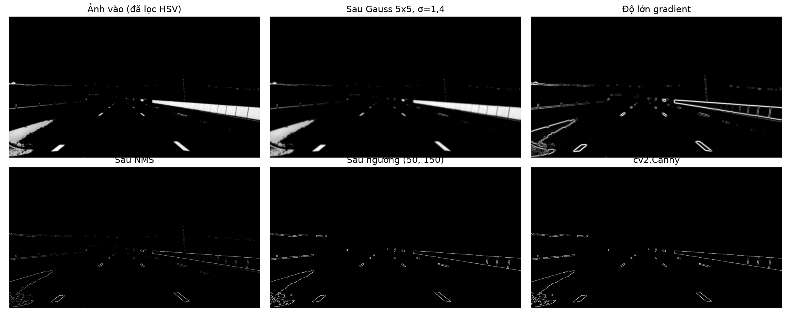
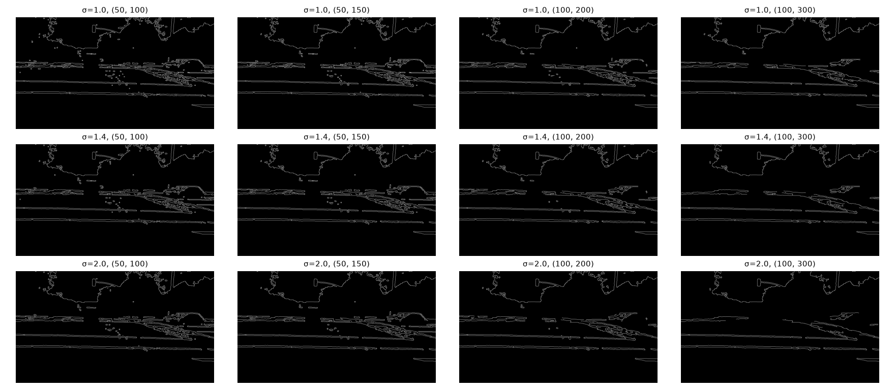
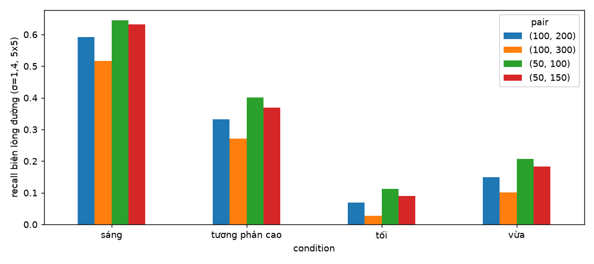
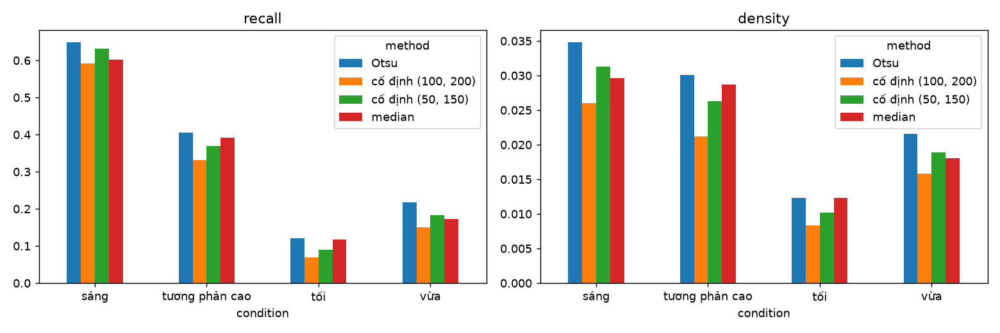

# BÁO CÁO PHẦN 3 CANNY PHÁT HIỆN CẠNH CHO BIÊN ĐƯỜNG

*Tự cài Canny, khảo sát tham số theo điều kiện ánh sáng và so sánh ngưỡng cố định với ngưỡng tự động*

## 1 Mục tiêu và phạm vi

Pipeline của nhóm gồm tiền xử lý HSV, Canny, ROI, Hough rồi chọn hai biên đường. Phần này chịu trách nhiệm bước Canny: nhận ảnh xám 960 × 540 đã lọc màu và làm mờ từ module tiền xử lý, trả về ảnh cạnh nhị phân 0/255 để ROI và Hough ở phía sau sử dụng. Ba bài báo của nhóm [1], [2], [3] đều dùng Canny nhưng không công bố giá trị ngưỡng, nên các tham số trong báo cáo này là thực nghiệm của nhóm.

Báo cáo trả lời bốn câu hỏi:

1. Bốn bước của Canny hoạt động thế nào, và bản tự cài bằng NumPy có khớp `cv2.Canny` không.
2. σ, kích thước nhân Gauss, cặp ngưỡng thấp/cao và tham số Sobel ảnh hưởng đến ảnh cạnh ra sao.
3. Cặp ngưỡng nào phù hợp với từng điều kiện ánh sáng.
4. Ngưỡng tự động theo trung vị và theo Otsu có khắc phục được điểm yếu của ngưỡng cố định mà Munajat và cộng sự [3] nêu ra hay không.

**Ranh giới đánh giá.** Chất lượng cuối cùng của Canny phải được đo qua toàn pipeline (ROI, Hough, hai biên đường). Phần đó thuộc giai đoạn sau và chưa nằm trong báo cáo này. Mọi con số ở đây chỉ đo riêng ảnh cạnh bằng một chỉ số tạm (mục 6) và chỉ dùng để so sánh các cấu hình với nhau. Chúng không phải kết luận về độ chính xác phát hiện biên đường.

## 2 Bốn bước của Canny

Wang và cộng sự [2] gộp Canny thành ba mục. Báo cáo này tách thành bốn bước để trình bày rõ hơn.

| Bước | Tên | Nội dung |
|---|---|---|
| 1 | Lọc Gauss | Nhân chập ảnh với nhân Gauss kích thước 5 × 5 hoặc 7 × 7. σ lớn làm ảnh mịn hơn nhưng nhòe biên. |
| 2 | Gradient Sobel | Hai nhân 3 × 3 cho Gx và Gy. Độ lớn M = √(Gx² + Gy²), hướng θ = arctan(Gy / Gx). |
| 3 | Loại điểm không cực đại | Chỉ giữ điểm có gradient lớn nhất theo hướng gradient, để cạnh mảnh một pixel. |
| 4 | Ngưỡng kép và hysteresis | Điểm có M ≥ Th là cạnh mạnh, M < Tl bị loại. Điểm ở giữa chỉ giữ nếu nối với cạnh mạnh. |

Nhân Gauss hai chiều:

`G(x,y) = 1 / (2πσ²) × exp(-(x² + y²) / (2σ²))`

Hai nhân Sobel:

| −1 | 0 | +1 |
|---|---|---|
| −2 | 0 | +2 |
| −1 | 0 | +1 |

(nhân Sx cho Gx; nhân Sy là chuyển vị của Sx.)

Phần hysteresis là kiến thức chuẩn từ Canny (1986) [4]; hai bài báo của Wang và Belhadri chỉ nhắc sơ.

## 3 Bản tự cài bằng NumPy

Bản tự cài gồm bốn hàm tương ứng bốn bước: `gaussian_smooth`, `sobel_gradient`, `non_max_suppression`, `hysteresis`, gộp trong `canny_edges(img, low, high, sigma)`. Hướng gradient được lượng tử hóa thành bốn hướng (0°, 45°, 90°, 135°) khi so sánh với hai điểm lân cận. Hysteresis lặp việc mở rộng cạnh mạnh sang các điểm yếu kề cạnh cho đến khi không đổi.



*Hình 3.1 Các bước trung gian trên ảnh normal_05 với Gauss 5 × 5, σ = 1,4, ngưỡng (50, 150), so với `cv2.Canny`.*

So với `cv2.Canny` (cùng Gauss 5 × 5, σ = 1,4, ngưỡng (50, 150), L2gradient bật) trên 50 ảnh, tỉ lệ giao trên hợp (IoU) của hai ảnh cạnh là 0,952 trung bình và 0,919 thấp nhất. Khi thay riêng bước Gauss bằng `cv2.GaussianBlur` và giữ nguyên các bước còn lại, IoU tăng lên 0,989 (đo trên 10 ảnh mẫu), nên phần lớn độ lệch đến từ bước Gauss: OpenCV làm tròn kết quả về `uint8`, còn bản tự cài giữ số thực. Phần lệch còn lại (khoảng 1%) nhiều khả năng đến từ cách xử lý điểm có gradient bằng nhau ở NMS, chưa được tách riêng để kiểm chứng. Với mục đích so sánh tham số, mức khớp này đủ dùng. Năm bài test tự động kiểm tra nhân Gauss, Sobel trên biên thẳng đứng, độ mảnh của cạnh sau NMS, hysteresis và ảnh phẳng không có cạnh.

Các thí nghiệm về tham số ở các mục sau dùng `cv2.Canny` để chạy nhanh trên toàn bộ lưới; ảnh cạnh bàn giao cho ROI và Hough dùng bản tự cài.

## 4 Ảnh hưởng của tham số

Lưới thí nghiệm gồm σ ∈ {1,0; 1,4; 2,0}, nhân Gauss 5 × 5 và 7 × 7, bốn cặp ngưỡng (thấp, cao) ∈ {(50, 100), (50, 150), (100, 200), (100, 300)}, tức tỉ lệ cao:thấp từ 2:1 đến 3:1. Hình 3.2 là một ví dụ trên ảnh adverse_13; hai ảnh lưới còn lại (normal_05, curved_05) nằm trong `outputs/canny/figures`.



*Hình 3.2 Ảnh cạnh của adverse_13 theo σ (hàng) và cặp ngưỡng (cột).*

Bảng 3.1 là giá trị trung bình trên 50 ảnh, nhân 5 × 5, đầu vào là ảnh đã lọc HSV. Recall và density được định nghĩa ở mục 6.

| Cặp ngưỡng | Recall σ=1,0 | Recall σ=1,4 | Recall σ=2,0 | Density σ=1,0 | Density σ=1,4 | Density σ=2,0 |
|---|---:|---:|---:|---:|---:|---:|
| (50, 100) | 0,312 | 0,302 | 0,297 | 0,024 | 0,023 | 0,022 |
| (50, 150) | 0,291 | 0,277 | 0,271 | 0,022 | 0,021 | 0,019 |
| (100, 200) | 0,260 | 0,245 | 0,231 | 0,019 | 0,017 | 0,016 |
| (100, 300) | 0,220 | 0,191 | 0,152 | 0,015 | 0,012 | 0,010 |

*Bảng 3.1 Recall và density theo cặp ngưỡng và σ.*

Nhận xét:

- **Ngưỡng:** nâng ngưỡng làm số điểm cạnh giảm đều (density giảm gần một nửa từ (50, 100) xuống (100, 300)) và recall giảm theo. Đây là đánh đổi trực tiếp giữa việc giữ đủ biên và việc giảm cạnh nhiễu cho Hough.
- **σ:** σ lớn làm cạnh ít hơn và nhòe hơn. Ảnh hưởng của σ nhỏ khi ngưỡng thấp, nhưng lớn khi ngưỡng cao: ở (100, 300), recall giảm từ 0,220 xuống 0,152 khi σ tăng từ 1,0 lên 2,0.
- **Nhân 5 × 5 và 7 × 7:** khác biệt rất nhỏ ở ngưỡng thấp (recall 0,302 và 0,296 với (50, 100), σ = 1,4) và rõ hơn ở ngưỡng cao ((100, 300): 0,191 và 0,156). Wang ghi nhân “7 × 3”, nhiều khả năng là lỗi in của 7 × 7; kết quả cho thấy chọn 5 × 5 hay 7 × 7 không phải yếu tố quyết định, nên nhóm dùng 5 × 5 vì nhanh hơn.
- **Sobel:** với σ = 1,4 và ngưỡng (50, 150), apertureSize = 3 cho recall 0,296 (L2gradient tắt) và 0,277 (bật); apertureSize = 5 cho 0,354 và 0,353, nhưng density tăng từ khoảng 0,022 lên 0,034. Sobel 5 × 5 gần như chỉ đưa thêm cạnh vào, nên không có cơ sở để coi nó tốt hơn; nhóm giữ apertureSize = 3. Bài của Wang và Belhadri đều dùng Sobel 3 × 3.

## 5 Thử theo điều kiện ánh sáng

Dataset chỉ có nhãn nhóm (Normal, Curved, Adverse). Để thử theo điều kiện ánh sáng, mỗi ảnh được gán một nhãn dựa trên độ sáng trung bình và độ lệch chuẩn của ảnh xám trong vùng lòng đường (ground truth):

- **tối**: sáng trung bình dưới 60.
- **tương phản cao** (nắng gắt hoặc bóng đổ): độ lệch chuẩn từ 40 trở lên, sáng trung bình từ 60.
- **sáng**: sáng trung bình trên 110, độ lệch chuẩn dưới 40.
- **vừa**: các ảnh còn lại.

| Nhóm | sáng | tương phản cao | tối | vừa |
|---|---:|---:|---:|---:|
| Normal (18) | 4 | 5 | 2 | 7 |
| Curved (12) | 1 | 4 | 3 | 4 |
| Adverse (20) | 2 | 6 | 8 | 4 |
| Tổng (50) | 7 | 15 | 13 | 15 |

*Bảng 3.2 Số ảnh theo nhóm và điều kiện.*

Các ngưỡng này là quy tắc do nhóm tự đặt, không phải nhãn thủ công về thời tiết hay mặt đường. Đường ẩm và đường có vạch hay không có vạch chưa được tách riêng.



*Hình 3.3 Recall của ảnh cạnh theo điều kiện và cặp ngưỡng (σ = 1,4, nhân 5 × 5).*

Điều kiện ảnh hưởng mạnh hơn cặp ngưỡng. Với cùng cặp ngưỡng (50, 150), recall là 0,632 ở ảnh sáng, 0,369 ở ảnh tương phản cao, 0,182 ở ảnh vừa và chỉ 0,090 ở ảnh tối. Ảnh tối có rất ít điểm cạnh (density 0,010 so với 0,031 ở ảnh sáng) nhiều khả năng vì bộ lọc HSV (ngưỡng V cố định) loại gần hết điểm ảnh khi độ sáng thấp, nên không còn nhiều gradient để Canny bắt. Nhóm chưa kiểm tra riêng điều này.

Bảng 3.3 chọn, cho mỗi điều kiện, cấu hình có recall cao nhất trong số các cấu hình có density không vượt 2,5%. Mức 2,5% là giả định của nhóm về lượng điểm cạnh mà Hough còn xử lý ổn, chưa được kiểm chứng bằng pipeline.

| Điều kiện | Số ảnh | σ | Nhân | Cặp ngưỡng | Recall | Density |
|---|---:|---:|---:|---|---:|---:|
| sáng | 7 | 2,0 | 7 × 7 | (50, 150) | 0,600 | 0,025 |
| tương phản cao | 15 | 2,0 | 7 × 7 | (50, 100) | 0,368 | 0,025 |
| vừa | 15 | 1,0 | 5 × 5 | (50, 100) | 0,223 | 0,022 |
| tối | 13 | 1,0 | 5 × 5 | (50, 100) | 0,117 | 0,012 |

*Bảng 3.3 Cấu hình ngưỡng cố định gợi ý theo điều kiện (gợi ý tạm thời).*

Xu hướng đáng chú ý: ảnh sáng và tương phản cao cần σ lớn để giữ density trong giới hạn, còn ảnh vừa và tối cần σ nhỏ và ngưỡng thấp để không mất cạnh. Cấu hình tối ở bảng chưa chạm giới hạn density, nên có thể giảm ngưỡng thấp hơn nữa; lưới hiện tại chưa thử các ngưỡng dưới 50. Mỗi nhãn chỉ có 7 đến 15 ảnh, nên các gợi ý này cần kiểm tra lại bằng pipeline đầy đủ.

## 6 Chỉ số tạm cho riêng Canny

Ground truth của bộ dữ liệu là vùng lòng đường, không phải nhãn pixel của vạch hay biên làn. Hai chỉ số dưới đây được tính từ đường biên của vùng này (bỏ phần sát khung ảnh):

- **Recall:** tỉ lệ điểm trên biên vùng lòng đường có ít nhất một điểm cạnh Canny trong bán kính 5 pixel.
- **Density:** tỉ lệ điểm cạnh trên tổng số pixel của ảnh, dùng làm thước đo lượng cạnh mà Hough phải xử lý.

Precision có thể tính cùng cách nhưng không dùng để kết luận, vì cạnh của vạch kẻ nằm trong lòng đường và cạnh của xe, biển báo cũng bị tính là sai, trong khi các cạnh này lại hữu ích hoặc vô hại cho Hough. Recall thấp trong báo cáo này không có nghĩa Canny hoạt động kém. Nhiều khả năng nó phản ánh việc vạch trắng và vàng chỉ là một phần của biên vùng lòng đường; phần còn lại là chỗ chuyển giữa mặt đường và lề, thường không phải vạch.

## 7 Ngưỡng tự động

Hai cách chọn ngưỡng theo từng ảnh được thử, đều với Gauss 5 × 5, σ = 1,4:

- **Theo trung vị:** thấp = 0,67 × median, cao = 1,33 × median, với median tính trên các pixel khác 0 (vì ảnh lọc HSV có nhiều nền đen).
- **Theo Otsu:** cao = ngưỡng Otsu, thấp = 0,5 × cao.



*Hình 3.4 Recall và density theo điều kiện, ngưỡng cố định so với ngưỡng tự động (đầu vào đã lọc HSV).*

| Điều kiện | Cố định (50, 150) | Cố định (100, 200) | Median | Otsu |
|---|---:|---:|---:|---:|
| sáng | 0,632 / 0,031 | 0,591 / 0,026 | 0,603 / 0,030 | 0,649 / 0,035 |
| tương phản cao | 0,369 / 0,026 | 0,332 / 0,021 | 0,391 / 0,029 | 0,405 / 0,030 |
| vừa | 0,182 / 0,019 | 0,150 / 0,016 | 0,173 / 0,018 | 0,217 / 0,022 |
| tối | 0,090 / 0,010 | 0,068 / 0,008 | 0,118 / 0,012 | 0,121 / 0,012 |

*Bảng 3.4 Recall / density trung bình theo điều kiện.*

Nhận xét:

- Ngưỡng tự động tự hạ ngưỡng ở ảnh tối: ngưỡng thấp của Otsu dao động từ 25 đến 61, của median từ 10 đến 155, trong khi ngưỡng cố định không đổi. Nhờ đó recall ở ảnh tối tăng từ 0,090 lên 0,118 (median) và 0,121 (Otsu).
- Phần tăng recall đi kèm tăng density, nên chưa thể coi tự động là tốt hơn ở cùng mức nhiễu. Ví dụ ở ảnh sáng, Otsu có recall cao nhất (0,649) nhưng cũng có density cao nhất (0,035), vượt giả định 2,5%.
- Mức chênh density giữa ảnh tối và ảnh sáng là khoảng 3,1 lần với cố định (100, 200), 3,1 lần với cố định (50, 150), 2,4 lần với median và 2,8 lần với Otsu. Median giảm sự chênh lệch nhiều nhất nhưng chỉ giảm được một phần: ngưỡng tự động giúp ổn định hơn, nhưng không loại bỏ hẳn vấn đề Munajat nêu.
- Median là cách chọn ngưỡng ổn định nhất theo lượng cạnh, Otsu cho recall cao nhất nhưng nhiều cạnh nhất. Chưa có kết luận rõ về cách nào tốt hơn cho Hough.

**So với ảnh xám thường.** Cùng các thí nghiệm này cũng được chạy trên ảnh xám làm mờ không qua lọc HSV. Với ngưỡng median, recall là 0,431 so với 0,284 ở ảnh lọc HSV; với Otsu là 0,390 so với 0,309; với cố định (50, 150) là 0,314 so với 0,277. Kết quả này phù hợp với cảnh báo của Wang và Belhadri: lọc màu giữ vạch trắng và vàng nhưng làm mất biên giữa mặt đường và lề, nên ảnh cạnh sau lọc HSV có ít điểm trên biên vùng lòng đường hơn. Cần nhớ rằng chỉ số tạm ở đây đo biên vùng lòng đường, không đo vạch kẻ, nên con số này không đủ để kết luận rằng bước HSV làm pipeline kém đi. Câu hỏi đó chỉ trả lời được khi chạy cả hai nhánh qua Hough.

## 8 Bàn giao

Ảnh cạnh cho ROI và Hough được ghi ở `outputs/canny/edges/{normal,curved,adverse}/*.png`, cùng kích thước 960 × 540, một kênh, giá trị 0 hoặc 255, tạo bằng Canny tự cài với cấu hình mặc định (50, 150), σ = 1,4, nhân 5 × 5. Mọi bảng số liệu được lưu dạng CSV trong `outputs/canny` (`fixed_results.csv`, `auto_results.csv`, `best_fixed_by_condition.csv`, `conditions.csv`).

Giao diện hàm:

```text
canny_edges(img, low, high, sigma, size=5, l2=True) -> ảnh uint8 giá trị 0/255
```

Khuyến nghị tham số tạm thời:

| Tình huống | Gợi ý |
|---|---|
| Mặc định cho mọi ảnh | σ = 1,4, nhân 5 × 5, ngưỡng (50, 150) |
| Ánh sáng thay đổi nhiều giữa các ảnh | Ngưỡng theo trung vị, vì lượng cạnh ổn định nhất |
| Ảnh sáng hoặc tương phản cao | σ = 2,0 và nhân 7 × 7 để giữ lượng cạnh trong giới hạn |
| Ảnh tối | σ = 1,0 và ngưỡng thấp; có thể thử ngưỡng dưới 50 |

## 9 Hạn chế và việc còn lại

- Chất lượng cuối cùng của Canny chưa được đo qua ROI, Hough và hai biên đường; các gợi ý ở mục 5 và 8 cần kiểm tra lại ở giai đoạn đó.
- Chỉ số tạm đo theo biên vùng lòng đường, không phải vạch hay biên làn, nên recall tuyệt đối thấp và chỉ có ý nghĩa để so sánh tương đối.
- Nhãn điều kiện được gán bằng quy tắc độ sáng và độ lệch chuẩn, chưa phân biệt đường ẩm, đường có vạch hay không có vạch; mỗi nhãn chỉ có 7 đến 15 ảnh.
- Bộ ngưỡng Phụ lục A của tài liệu hướng dẫn chỉ là điểm bắt đầu. Các ngưỡng dưới 50 và nhân Gauss lớn hơn chưa được khảo sát.
- Phần tăng recall của ngưỡng tự động đi kèm tăng lượng cạnh; cần xem Hough xử lý lượng cạnh này thế nào trước khi chọn.
- Tài liệu hướng dẫn nêu mục tiêu thời gian dưới 50 ms mỗi khung cho toàn pipeline [1]. Bản NumPy tự cài mất khoảng 0,2 đến 0,3 giây mỗi ảnh nên không phù hợp để chạy thời gian thực; `cv2.Canny` nhanh hơn nhiều và nên dùng nếu cần tốc độ.

## 10 Nội dung nên trình bày trên slide

Phần Canny chỉ chiếm một đoạn trong bài thuyết trình của nhóm, nên slide chỉ nên đi theo một mạch: **làm rõ việc cần làm, thể hiện cách làm, cài đặt và kết quả, kết luận**. Sáu slide dưới đây bám theo mạch đó. Các con số và hình đều lấy từ các mục phía trên.

| Slide | Mạch | Nội dung chính | Hình hoặc bảng | Thông điệp |
|---|---|---|---|---|
| 1 | Làm rõ nội dung | Bài toán tìm biên đường; Canny nằm giữa tiền xử lý HSV và ROI + Hough; đầu vào là ảnh xám 960 × 540, đầu ra là ảnh cạnh nhị phân. Hai câu hỏi cần trả lời: chọn tham số nào, và ngưỡng cố định có đủ không. | Sơ đồ pipeline một dòng | Canny phải giữ được biên đường mà ít nhiễu để Hough làm việc được |
| 2 | Thể hiện nội dung | Bốn bước: Gauss, Sobel, NMS, ngưỡng kép với hysteresis. Chỉ nêu công thức Gauss, ma trận Sobel và quy tắc hai ngưỡng. | Hình 3.1 (các bước trung gian) | Mỗi bước làm gì và tham số nào do ta chọn (σ, Tl, Th) |
| 3 | Cài đặt | Tự cài bằng NumPy, hàm `canny_edges(img, low, high, sigma)`. Kiểm tra với `cv2.Canny`: IoU 0,952 trung bình; phần lệch chủ yếu do OpenCV làm tròn kết quả Gauss. | Hình 3.1 lại, hoặc một dòng số IoU | Bản tự cài đáng tin để dùng so sánh tham số |
| 4 | Cài đặt | Khảo sát σ × ngưỡng và theo điều kiện ánh sáng (sáng, tương phản cao, vừa, tối). Ngưỡng càng cao thì ít cạnh hơn nhưng mất biên; ảnh tối bắt được ít cạnh nhất. | Hình 3.2 (một lưới) và Hình 3.3 | Không có một cặp ngưỡng tốt cho mọi ảnh |
| 5 | Cài đặt | Ngưỡng tự động theo median và Otsu so với cố định: tự hạ ngưỡng ở ảnh tối nên recall tăng, nhưng lượng cạnh cũng tăng; chênh lệch lượng cạnh giữa ảnh tối và ảnh sáng giảm từ 3,1 lần xuống 2,4 đến 2,8 lần. | Hình 3.4, hoặc bản rút gọn của Bảng 3.4 | Ngưỡng tự động giúp ổn định hơn nhưng chưa giải quyết hết vấn đề của Munajat |
| 6 | Kết luận | Khuyến nghị: mặc định σ = 1,4, nhân 5 × 5, ngưỡng (50, 150); ánh sáng thay đổi nhiều thì dùng ngưỡng theo median. Hạn chế: số liệu chỉ đo riêng Canny; chưa đánh giá qua ROI và Hough; nhãn điều kiện suy ra từ độ sáng. Bước tiếp theo: đo qua toàn pipeline rồi chọn lại tham số. | Bảng khuyến nghị ở mục 8 | Có tham số khởi điểm cho nhóm, và biết phần nào còn phải kiểm chứng |

*Bảng 3.5 Dàn sáu slide cho phần Canny.*

Nên để lại trong báo cáo, không đưa lên slide:

- So sánh nhân 5 × 5 và 7 × 7, và so sánh Sobel apertureSize 3 và 5 (mục 4); chỉ cần nói miệng nếu bị hỏi.
- Định nghĩa chi tiết recall và density (mục 6). Trên slide chỉ cần một dòng: recall là biên lòng đường có cạnh gần đó, density là lượng cạnh Hough phải xử lý.
- So sánh ảnh xám thường với ảnh lọc HSV (cuối mục 7). Đây là phát hiện thú vị nhưng thuộc về đánh giá toàn pipeline, nên chỉ dùng khi trả lời câu hỏi.
- Ba lưới tham số còn lại ngoài ảnh được chọn, và bảng số đầy đủ.

Khi trình bày, nên nói rõ ngay từ slide 1 rằng các số liệu đo riêng ảnh cạnh và dùng để so sánh cấu hình, để người nghe không hiểu nhầm recall là độ chính xác phát hiện biên đường.

## Tài liệu tham khảo

[1] Y. Belhadri, D. Mohamed, B. Alshaqaqi, and A. S. Baquhaizel, “Lane Boundary Detection in Dynamic Environments,” *Rev. Roum. Sci. Techn. - Électrotechn. et Énerg.*, vol. 71, no. 2, pp. 299-304, 2026.

[2] S. Wang, S. Wu, X. Wang, and Z. Li, “A Canny Operator Road Edge Detection Method Based on Color Features,” *Journal of Physics: Conference Series*, vol. 1629, 012018, 2020.

[3] M. D. E. Munajat, D. H. Widyantoro, and R. Munir, “Road Detection System Based on RGB Histogram Filterization and Boundary Classifier,” *ICACSIS*, pp. 195-200, 2015.

[4] J. F. Canny, “A Computational Approach to Edge Detection,” *IEEE Trans. Pattern Analysis and Machine Intelligence*, vol. 8, no. 6, pp. 679-698, 1986.
